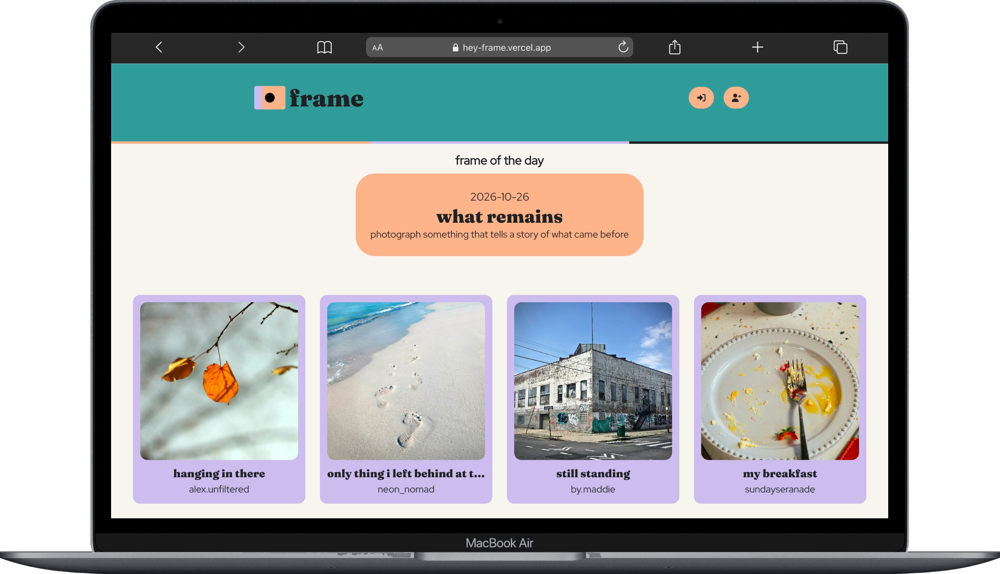
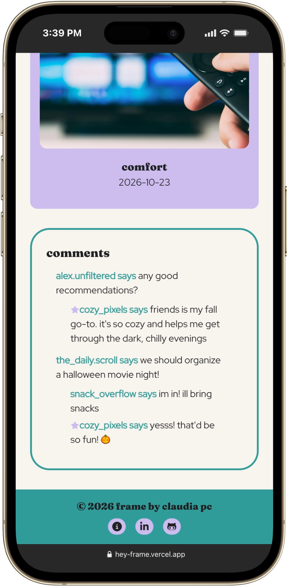

# Frame 📸

### A daily photography challenge where everyday moments become something worth sharing. ###
### Live Site: https://hey-frame.vercel.app/ ###

<p align="center">
  
  
</p>

Frame is a mindfulness photography community built around daily prompts. Each day, users get a new photography challenge, capture a moment inspired by the prompt, and share their photos with the community. Users can explore other people's interpretations, leave comments, and connect through photography.

## 🖼️ How It Works

1. Users sign in to Frame.
2. They discover the daily photography prompt.
3. They take or choose a photo that fits the theme.
4. They give their post a title and publish it.
5. Other users can view the photo and join the conversation through comments and replies.

Each prompt encourages users to notice something new in their everyday surroundings and capture that one fleeting moment, interpreting the same theme in their own unique way.

## ✨ Features

### Home page

- **Daily photography prompts** — Discover the daily photography challenge.
- **Daily posts** — Browse photos shared by the community in response to the day's prompt.
- **Community feed** — Browse posts shared by different users.

### Guest access

- **Public browsing** — Visitors who aren't logged in can access the homepage and view the day's posts.
- **Read-only comments** — Read existing comments and replies, but sign-in is required to participate in discussions.

### Authenticated users

Logged-in users can access all homepage features, plus:

- **Share photos** — Create posts with a title and an image inspired by a photography prompt.
- **Comments and replies** — Start conversations and reply to other users.
- **Post management** — Edit your own posts and delete posts or comments where permitted.
- **Prompt galleries** — Browse posts associated with specific photography prompts, including past prompts.
- **Search posts** - Find posts by title.

### Admin

- **Prompt management** — Create and manage daily photography prompts.
- **Moderation permissions** — Delete posts and comments when necessary.

## 🛠️ Built With

- [Next.js](https://nextjs.org/)
- [TypeScript](https://www.typescriptlang.org/)
- [Tailwind CSS](https://tailwindcss.com/)
- [Supabase](https://supabase.com/)
- [Vercel](https://vercel.com/)

## 📁 Project Structure

```text
actions/                    # Server actions for mutations

app/
├── (main)/                 # Main application pages and layouts
│   └── [date]/[slug]/      # Individual posts
│        └── edit           # Edit page for individual posts
│   └── about               # About Frame
│   └── admin               # Admin page for managing prompts
│   └── create              # Create page for posts
│   └── past-prompts        # Prompts from the past week
│        └── [date]         # Posts from past prompts
├── auth/                   # Authentication pages
│   └── login               # Login page
│   └── signup              # Signup page
└── not-found.tsx           # Custom 404 page

components/                 # Reusable components

lib/
└── supabase/               # Supabase clients, queries and helpers
```

Built as a mindfulness photography-focused social web application.

## Grateful for any feedback or suggestions! Thank you! 🙏 ##